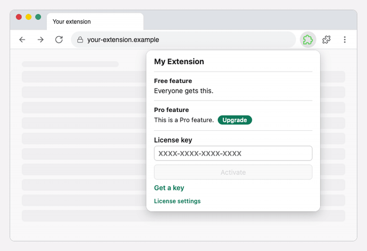

# Keyturn Kit

Sell a Chrome extension with Lemon Squeezy license keys. No server, no secret key in the extension.

Google wound down Chrome Web Store payments between 2020 and early 2021, so a paid extension has to sort out payment, license keys, offline use and refunds on its own. Lemon Squeezy takes the payment. This starter handles the license keys, offline use and disabled keys in about 500 lines of TypeScript.

Built on [WXT](https://wxt.dev), React and TypeScript, Manifest V3. Listed in the [WXT community resources](https://wxt.dev/guide/resources/community). Firefox builds come from WXT (`npm run zip:firefox`). That build passes Mozilla's `web-ext lint` with no errors (two warnings, both inside React DOM), but we haven't tried it by hand in Firefox yet.



You can try the popup before cloning: [keyturnkit.github.io](https://keyturnkit.github.io) runs it in the page. Paste `KEYTURN-DEMO-2026` and press Activate to see Pro turn on, or any other key to see the error your users would get.

Selling through Polar, Dodo Payments, Gumroad or Payhip instead, or want a free trial before the paywall? That's [Keyturn Kit Pro](#keyturn-kit-pro), $59 once.

## What happens when someone pays

1. The user clicks **Get a key** and pays on your Lemon Squeezy checkout.
2. Lemon Squeezy emails them a license key.
3. They paste it into the popup. The extension activates it with the public [License API](https://docs.lemonsqueezy.com/api/license-api). No API key ships in the extension. The options page also opens once right after install, so someone who paid first can paste the key straight away.
4. Once a day, while the browser is open, the extension re-checks the key. Keys that Lemon Squeezy reports as invalid or disabled lock Pro on the next check. When you refund an order, make sure its key is disabled in the dashboard (Lemon Squeezy's docs don't say whether a refund does this on its own). If the license server can't be reached, Pro keeps working for 7 days after the last good check.

Keys from other Lemon Squeezy stores are rejected by `store_id`, so a key bought from someone else's store won't turn on your Pro features.

## Quick start

```bash
npm install
npm run dev        # opens Chrome with the extension loaded
npm test           # license logic tests, no network
npm run build      # .output/chrome-mv3
npm run zip        # store-ready zip
```

Edit `lib/config.ts`:

```ts
checkoutUrl: 'https://your-store.lemonsqueezy.com/buy/...',
lemonsqueezy: { storeId: 12345, productIds: [] },
```

Also set `name` and `description` in `wxt.config.ts`.

In Lemon Squeezy, turn on **Generate license keys** for the product and set an **activation limit** (for example 3 browsers per key). Try the whole flow in test mode with a test card before going live.

When you go live, copy the product to live mode in Lemon Squeezy. The copy gets a new product ID and a new checkout link, so update `productIds` and `checkoutUrl`. Otherwise your customers' real keys are rejected as belonging to another product.

## Gating features

```tsx
<ProGate>
  <BulkExport />
</ProGate>
```

```ts
if (await license.isPro()) { ... }
```

## Files

```
lib/config.ts                       checkout link, store id, re-check timing
lib/license/manager.ts              activation, daily re-check, offline grace, disabled keys
lib/license/providers/lemonsqueezy.ts
components/ProGate.tsx              show children only to Pro users
components/LicenseForm.tsx          enter key, see status, move key to another browser
entrypoints/background.ts           daily re-check
tests/                              tests with mocked fetch
```

## Limits

A determined user can patch any client-side check. What this does stop is sharing a key past the activation limit you set, and using a key you have disabled. For stronger protection, gate a server feature.

## Keyturn Kit Pro

The paid edition ($59, one-time) adds:

- a free trial counted from install, and a daily number of free uses per feature
- Polar, Dodo Payments, Gumroad and Payhip next to Lemon Squeezy, switched in `lib/config.ts`
- AGENTS.md so Claude Code or Cursor adds paid features the right way

[Get Pro, $59](https://buy.polar.sh/polar_cl_lbYlQnZT7FFPBcNrAdcwK1gqzx45xyNy3anEs3twjGy). Polar handles payment and tax; you get the source as a zip. It's also [on Gumroad](https://mamstudiohq.gumroad.com/l/hhecqu) if you'd rather pay there.

There are guides with the code for [Polar](https://keyturnkit.github.io/guides/polar-license-keys-chrome-extension/), [Dodo Payments](https://keyturnkit.github.io/guides/dodo-license-keys-chrome-extension/), [Gumroad](https://keyturnkit.github.io/guides/gumroad-license-keys-chrome-extension/) and [Payhip](https://keyturnkit.github.io/guides/payhip-license-keys-chrome-extension/) license keys, and [a free trial for a paid extension](https://keyturnkit.github.io/guides/chrome-extension-free-trial/). If you're weighing a move away from Lemon Squeezy as it shifts toward Stripe Managed Payments, [this comparison](https://keyturnkit.github.io/guides/move-license-keys-off-lemon-squeezy/) covers the four.

## License

MIT
